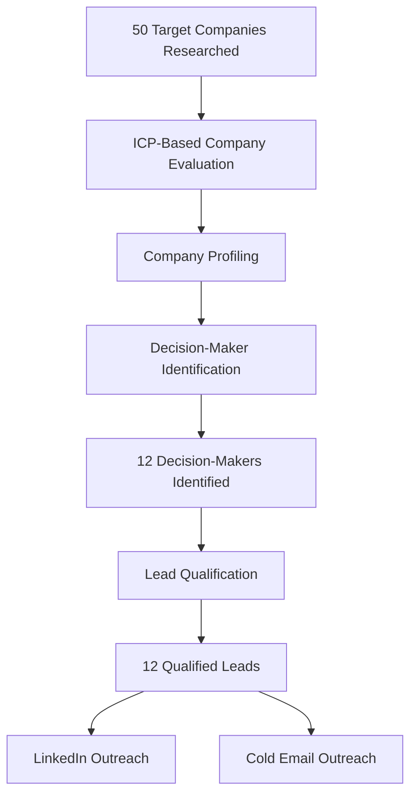
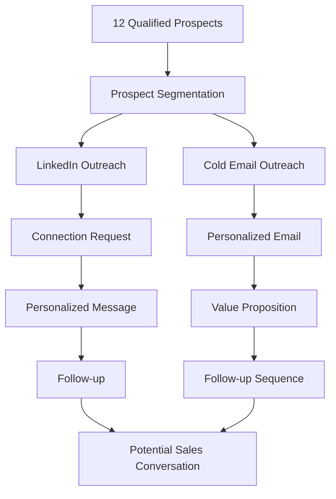

# B2B Lead Generation & Prospect Research

### US Market | Web Development Industry | B2B Sales Development

A structured B2B prospect research project focused on identifying US-based web development agencies, researching key decision-makers, developing an Ideal Customer Profile (ICP), and preparing qualified prospects for outbound sales engagement.

---

## 📊 Project Performance Dashboard

<table width="100%">
  <tr>
    <td align="center" width="25%">
      <h1>50</h1>
      <b>Companies Researched</b>
       
      Target Accounts
    </td>
    <td align="center" width="25%">
      <h1>12</h1>
      <b>Decision-Makers</b>
       
      Contacts Identified
    </td>
    <td align="center" width="25%">
      <h1>12</h1>
      <b>Qualified Leads</b>
       
      Research Qualified
    </td>
    <td align="center" width="25%">
      <h1>24%</h1>
      <b>Account-to-Lead Yield</b>
       
      Research Efficiency
    </td>
  </tr>
</table>

### Research Performance

| Performance Metric | Achievement |
|:---|---:|
| Companies Researched | 50 |
| Decision-Makers Identified | 12 |
| Qualified Leads | 12 |
| Research Platforms | 4 |
| Outreach Channels Planned | 2 |

**Account-to-Lead Yield**

`(12 Qualified Leads / 50 Researched Companies) × 100 = 24%`

## 1. 📌 Project Overview

| Project Attribute | Details |
|:---|:---|
| Project Type | B2B Lead Generation & Prospect Research |
| Target Geography | United States |
| Target Industry | Web Development |
| Target Accounts | Web Development Agencies |
| Company Size | 11–200 Employees |
| Business Model | B2B |
| Research Scope | 50 Companies |
| Decision-Makers Identified | 12 |
| Qualified Leads | 12 |
| Outreach Strategy | LinkedIn & Cold Email |
| Data Management | Microsoft Excel |
| CRM Context | HubSpot |

### Project Objectives

- Research 50 US-based web development companies.
- Identify relevant founders, CEOs and business development decision-makers.
- Develop an Ideal Customer Profile (ICP).
- Evaluate company fit and prospect relevance.
- Qualify leads based on business requirements.
- Develop structured outbound outreach strategies.

---

## 2. 🔄 End-to-End Research Workflow

The project followed a structured seven-stage research-to-outreach process, converting target market research into qualified B2B sales prospects.

### Research Workflow

<table width="100%">
  <tr>
    <td align="center" width="33%">
      <h3>01</h3>
      <b>🔎 Market Research</b>
       
      Identify US web development agencies
    </td>
    <td align="center" width="33%">
      <h3>02</h3>
      <b>🏢 Company Discovery</b>
       
      Find and shortlist target companies
    </td>
    <td align="center" width="33%">
      <h3>03</h3>
      <b>🎯 ICP Development</b>
       
      Define ideal customer criteria
    </td>
  </tr>
  <tr>
    <td colspan="3" align="center">
      ⬇️ <b>Company Evaluation & Profiling</b> ⬇️
    </td>
  </tr>
  <tr>
    <td align="center">
      <h3>04</h3>
      <b>📋 Company Profiling</b>
       
      Evaluate services, size and business models
    </td>
    <td align="center">
      <h3>05</h3>
      <b>👥 Decision-Maker Research</b>
       
      Identify founders, CEOs and sales leaders
    </td>
    <td align="center">
      <h3>06</h3>
      <b>✅ Lead Qualification</b>
       
      Evaluate company and prospect relevance
    </td>
  </tr>
  <tr>
    <td colspan="3" align="center">
      ⬇️ <b>Qualified Prospect Database</b> ⬇️
    </td>
  </tr>
  <tr>
    <td colspan="3" align="center">
      <h3>07 — 📬 Outbound Outreach Strategy</h3>
      Prepare prospect engagement and follow-up strategies
    </td>
  </tr>
  <tr>
    <td align="center">
      <b>💼 LinkedIn Outreach</b>
       
      Professional networking and personalized messaging
    </td>
    <td align="center">
      <b>✉️ Cold Email</b>
       
      Personalized emails and follow-up sequences
    </td>
    <td align="center">
      <b>📊 CRM Context</b>
       
      Prospect organization and pipeline tracking
    </td>
  </tr>
</table>

### Research Process Breakdown

| Stage | Activities | Output |
|:---|:---|:---|
| 01. Market Research | Identified US web development agencies | Target Market |
| 02. Company Discovery | Researched and shortlisted relevant businesses | 50 Companies |
| 03. ICP Development | Defined company size, geography and industry criteria | 1 ICP |
| 04. Company Profiling | Reviewed services, company size and business models | 50 Profiles |
| 05. Decision-Maker Research | Identified founders, CEOs and business development leaders | 12 Contacts |
| 06. Lead Qualification | Evaluated company and contact relevance | 12 Qualified Leads |
| 07. Outreach Planning | Prepared LinkedIn and email strategies | 2 Channels |

## 3. 🎯 Ideal Customer Profile (ICP)

The ICP was developed to identify web development agencies that could potentially benefit from CRM and sales pipeline management solutions.

### Target Company Profile

| Criteria | Target Specification |
|:---|:---|
| Geography | United States |
| Industry | Web Development |
| Company Size | 11–200 Employees |
| Business Model | B2B |
| Company Type | Web Development Agencies |
| Departments | Sales & Business Development |
| Potential Requirements | CRM, Lead Management, Sales Pipeline Tracking |

### Target Decision-Makers

| Designation | Department | Business Relevance |
|:---|:---|:---|
| Founder | Executive Leadership | Strategic and purchasing decisions |
| CEO | Executive Leadership | Business and technology decisions |
| Managing Director | Management | Operational improvements |
| VP of Sales | Sales | Sales operations and pipeline management |
| Head of Business Development | Business Development | Lead acquisition and relationship management |

---

## 4. 🏢 Company Research & Qualification

Each target company was evaluated against the defined ICP.

### Company Evaluation Framework

| Parameter | Research Focus |
|:---|:---|
| Geographic Fit | Is the company based in the United States? |
| Industry Fit | Does it operate in web development? |
| Company Size | Does it have 11–200 employees? |
| Business Model | Does it primarily serve business clients? |
| Services | What web development services does it provide? |
| Sales Operations | Does its business model involve client acquisition? |
| Potential Needs | Could CRM and pipeline management improve its operations? |

### Proposed Lead Scoring Framework

The following scoring model provides a structured approach for prospect prioritization.

| Qualification Criteria | Maximum Score |
|:---|---:|
| Industry Alignment | 25 |
| Company Size Alignment | 20 |
| Geographic Alignment | 15 |
| B2B Business Model | 15 |
| Decision-Maker Seniority | 15 |
| Potential CRM Requirement | 10 |
| **Total** | **100** |

| Score Range | Priority |
|:---|:---|
| 80–100 | High Priority |
| 60–79 | Medium Priority |
| Below 60 | Low Priority |

*Note: This is a proposed scoring framework, not a representation of historical scores assigned to the 12 leads.*

---

## 5. 🔍 Research Platforms & Tools

| Platform | Purpose | Application |
|:---|:---|:---|
| Google Search | Company Discovery | Identifying potential target accounts |
| Clutch | Company Research | Reviewing agency services and business information |
| LinkedIn | Prospect Identification | Finding relevant decision-makers |
| Company Websites | Information Verification | Validating company details |
| Microsoft Excel | Data Management | Organizing prospect information |
| HubSpot | CRM Workflow Context | Understanding prospect management and sales pipelines |

---

## 6. 🗂️ Prospect Database Architecture

The research data was organized into structured company and decision-maker records.

### A. Company Database

| Database Field | Description |
|:---|:---|
| Company Name | Business name |
| Website | Official company website |
| Location | US city and state |
| Industry | Web Development |
| Employee Range | Estimated company size |
| Services | Core business offerings |
| Business Model | B2B / B2C |
| ICP Alignment | Company fit assessment |
| Research Status | Identified / Reviewed / Qualified |

### B. Decision-Maker Database

| Database Field | Description |
|:---|:---|
| Contact Name | Identified professional |
| Job Title | Founder / CEO / VP Sales |
| Company | Associated target account |
| LinkedIn Profile | Professional profile URL |
| Department | Sales / Business Development / Leadership |
| Qualification Status | Qualified / Review Required |
| Outreach Channel | LinkedIn / Email |
| Follow-up Status | Planned / Pending / Contacted |

---

## 7. 📈 Lead Generation Funnel

The research process converted target company accounts into qualified prospects through ICP-based evaluation and decision-maker identification.

### Funnel Performance

| Research Stage | Count | Percentage |
|:---|---:|---:|
| Companies Researched | 50 | 100% |
| Decision-Makers Identified | 12 | 24% of researched companies |
| Qualified Leads | 12 | 100% of identified decision-makers |

**Account-to-Lead Yield: 24%**

*The 24% represents research yield, not an outreach response rate or sales conversion rate.*

---

## 8. 📬 Outbound Outreach Strategy

Two primary outbound channels were selected for prospect engagement.

### Channel Strategy

| Channel | Planned Activities | Objective |
|:---|:---|:---|
| LinkedIn | Profile research, connection requests and personalized messaging | Establish professional connections |
| Cold Email | Personalized emails, value propositions and follow-ups | Generate interest and initiate conversations |

*The project covered outreach strategy preparation. Actual outreach responses, meetings booked and conversions were not included in the reported results.*

---

## 9. 📂 Research Database & Excel Workbook

The complete prospect research data is maintained in the accompanying Excel workbook.

### Workbook Contents

| Research Component | Description |
|:---|:---|
| Company Research | 50 researched US-based web development companies |
| Decision-Maker Research | 12 identified business decision-makers |
| ICP Research | Target company profile and qualification criteria |
| Lead Research | Prospect relevance and qualification information |

### Download Research Workbook

📊 **[Download B2B Lead Generation Research Workbook](./B2B-Lead-Generation-Research.xlsx)**

*The Excel workbook contains the supporting research data for this project.*

---

## 10. 📦 Project Deliverables

| Deliverable | Output |
|:---|:---|
| Market Research | US web development agency research |
| ICP Development | Defined target company profile |
| Company Database | 50 Researched Companies |
| Prospect Database | 12 Decision-Makers |
| Lead Qualification | 12 Qualified Leads |
| Outreach Strategy | LinkedIn & Cold Email |
| Data Organization | Structured Excel Prospect Database |

---

## 11. 💡 Skills Demonstrated

| Category | Skills |
|:---|:---|
| Sales Development | B2B Lead Generation, Prospecting, Outbound Strategy |
| Market Research | Company Profiling, Industry Research |
| Lead Qualification | ICP Development, Lead Scoring, Prospect Qualification |
| Prospect Research | LinkedIn Prospecting, Decision-Maker Identification |
| Data Management | Microsoft Excel, CRM Data Management |
| Sales Operations | Sales Pipeline Management, HubSpot Workflow Context |

---

## 12. 🏆 Project Outcome

Successfully researched **50 US-based web development companies**, identified **12 relevant decision-makers**, and qualified **12 prospects** through an ICP-based research process.

### Key Achievements

- Researched 50 potential B2B target accounts.
- Developed an Ideal Customer Profile for the target market.
- Identified 12 relevant business decision-makers.
- Qualified 12 prospects based on company and contact relevance.
- Achieved a 24% account-to-lead yield.
- Developed LinkedIn and cold email outreach strategies.
- Organized prospect information in a structured Excel database.

### Final Results

| Metric | Achievement |
|:---|---:|
| Companies Researched | 50 |
| Decision-Makers Identified | 12 |
| Qualified Leads | 12 |
| Account-to-Lead Yield | 24% |
| Outreach Channels Planned | 2 |

---

## Project Information

| Attribute | Details |
|:---|:---|
| Project Type | B2B Sales Development & Lead Generation |
| Target Market | United States |
| Industry | Web Development |
| Research Output | 50 Companies |
| Prospect Output | 12 Decision-Makers |
| Qualification Output | 12 Qualified Leads |

**Core Competencies:** B2B Lead Generation · Prospect Research · ICP Development · Market Research · Decision-Maker Identification · Lead Qualification · CRM Data Management · LinkedIn Prospecting · Sales Pipeline Management · Microsoft Excel

